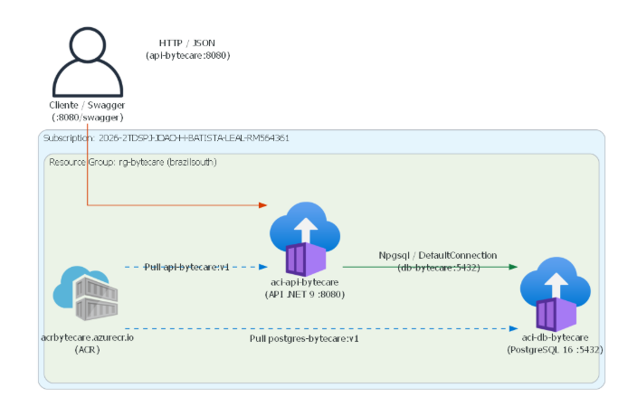

# Clyvo Vet API (ByteCare)

API RESTful desenvolvida em .NET 9.0 para projeto em colaboração com a divisão de medicina veterinária da empresa Clyvo, concebida para atender aos requisitos de arquitetura de software, qualidade e infraestrutura em nuvem Microsoft Azure.

---

## Integrantes da Equipe (ByteCare)
- **Erik Naoki Miyasato** - RM: 565771
- **Gustavo Arthur Carvalho Sartori** - RM: 561650
- **Gutemberg Rocha Silva** - RM: 562267
- **João Henrique Batista Leal** - RM: 564361
- **Juliana da Silva Stigliani** - RM: 561171

---

## Arquitetura da Solução de Software

A solução foi desenvolvida adotando princípios de Domain-Driven Design (DDD), Clean Architecture e padrão em camadas:

- **ClyvoVetChallenge.Domain:** Entidades de domínio com encapsulamento, enums de status e regras fundamentais do negócio veterinário.
- **ClyvoVetChallenge.Application:** DTOs de requisição e resposta, contratos de interfaces de serviços e repositórios, validações de entrada e orquestração das regras de aplicação.
- **ClyvoVetChallenge.Infrastructure:** Persistência via Entity Framework Core com mapeamento Fluent API, suporte a PostgreSQL 16 (produção e nuvem ACI) e SQLite para testes locais isolados, repositórios concretos e migrações versionadas.
- **ClyvoVetChallenge.Api:** Camada de apresentação RESTful com documentação Swagger/OpenAPI, autenticação JWT Bearer, tratamento global de erros no padrão RFC 9110 (ProblemDetails), logging estruturado Serilog, middleware de Correlation ID e instrumentação OpenTelemetry.
- **ClyvoVetChallenge.Tests.Unit:** 92 testes unitários com xUnit e Moq para isolamento rigoroso de regras de negócio e serviços.
- **ClyvoVetChallenge.Tests.Integration:** 31 testes de integração com `WebApplicationFactory` validando o ciclo HTTP completo, autorização, validação estrita de inicialização e códigos de status.

---

## Catálogo Completo de Endpoints

### 1. Autenticação e Segurança
- `POST /api/Auth/login`: Autentica o usuário e retorna o token de acesso JWT.
- `GET /api/Auth/perfil`: Retorna os dados do perfil autenticado (Requer `Authorization: Bearer <token>`).

### 2. Animais (`/api/Animal`)
- `GET /api/Animal`: Lista todos os animais cadastrados.
- `GET /api/Animal/{id}`: Busca um animal específico pelo ID.
- `POST /api/Animal`: Cadastra um novo animal (Valida que a data de nascimento não pode ser futura; retorna HTTP 422 em caso de violação).
- `PUT /api/Animal/{id}`: Atualiza os dados de um animal existente.
- `DELETE /api/Animal/{id}`: Remove um animal do sistema.

### 3. Clínicas Veterinárias (`/api/Clinica`)
- `GET /api/Clinica`: Lista todas as clínicas cadastradas.
- `GET /api/Clinica/{id}`: Busca uma clínica específica pelo ID.
- `POST /api/Clinica`: Cadastra uma nova clínica (validação de CNPJ).
- `PUT /api/Clinica/{id}`: Atualiza os dados de uma clínica existente.
- `DELETE /api/Clinica/{id}`: Remove uma clínica do sistema.

### 4. Consultas Veterinárias (`/api/Consulta`)
- `GET /api/Consulta`: Lista todas as consultas cadastradas.
- `GET /api/Consulta/{id}`: Busca uma consulta específica pelo ID.
- `GET /api/Consulta/animal/{animalId}`: Lista todas as consultas vinculadas a um animal.
- `POST /api/Consulta`: Agenda uma nova consulta vinculando animal, veterinário e clínica.
- `PUT /api/Consulta/{id}/resultado`: Registra diagnóstico, observações e altera o status da consulta.
- `DELETE /api/Consulta/{id}`: Cancela ou remove uma consulta do sistema.

### 5. Diários de Sintomas (`/api/Diario`)
- `GET /api/Diario`: Lista todos os registros de diário cadastrados.
- `GET /api/Diario/{id}`: Busca um registro de diário pelo ID.
- `GET /api/Diario/animal/{animalId}`: Lista todos os diários de um animal específico.
- `POST /api/Diario`: Cria um novo registro de diário de saúde para o animal.
- `PUT /api/Diario/{id}`: Atualiza anotações do diário.
- `DELETE /api/Diario/{id}`: Remove um registro de diário.
- `POST /api/Diario/{diarioId}/sintomas`: Adiciona um sintoma observado com nível de intensidade ao diário.
- `DELETE /api/Diario/{diarioId}/sintomas/{sintomaId}`: Remove um sintoma associado ao diário.

### 6. Tutores / Donos (`/api/Dono`)
- `GET /api/Dono`: Lista todos os donos cadastrados.
- `GET /api/Dono/{id}`: Busca um dono específico pelo ID.
- `POST /api/Dono`: Cadastra um novo dono (validação de CPF único).
- `PUT /api/Dono/{id}`: Atualiza informações de contato e endereço do dono.
- `DELETE /api/Dono/{id}`: Remove um dono do sistema.

### 7. Históricos Médicos (`/api/Historico`)
- `GET /api/Historico`: Lista todos os eventos de histórico médico.
- `GET /api/Historico/{id}`: Busca um registro de histórico pelo ID.
- `GET /api/Historico/animal/{animalId}`: Lista os registros médicos de um animal específico.
- `POST /api/Historico`: Registra um novo evento histórico para o animal.
- `PUT /api/Historico/{id}`: Atualiza descrição e resultados do histórico.
- `DELETE /api/Historico/{id}`: Remove um evento histórico.

### 8. Prescrições (`/api/Prescricao`)
- `GET /api/Prescricao`: Lista todas as prescrições cadastradas.
- `GET /api/Prescricao/{id}`: Busca uma prescrição específica pelo ID.
- `GET /api/Prescricao/consulta/{consultaId}`: Lista prescrições vinculadas a uma consulta.
- `POST /api/Prescricao`: Emite uma nova prescrição com medicamento, dosagem e duração.
- `PUT /api/Prescricao/{id}`: Atualiza posologia e observações da prescrição.
- `DELETE /api/Prescricao/{id}`: Remove uma prescrição.

### 9. Catálogo de Sintomas (`/api/Sintoma`)
- `GET /api/Sintoma`: Lista os tipos de sintomas pré-cadastrados.
- `GET /api/Sintoma/{id}`: Busca um tipo de sintoma pelo ID.
- `POST /api/Sintoma`: Cadastra um novo sintoma no catálogo.
- `PUT /api/Sintoma/{id}`: Atualiza nome e descrição do sintoma.
- `DELETE /api/Sintoma/{id}`: Remove um sintoma do catálogo.

### 10. Médicos Veterinários (`/api/Veterinario`)
- `GET /api/Veterinario`: Lista todos os veterinários cadastrados.
- `GET /api/Veterinario/{id}`: Busca um veterinário específico pelo ID.
- `POST /api/Veterinario`: Cadastra um novo veterinário (validação de CRMV).
- `PUT /api/Veterinario/{id}/contato`: Atualiza dados de contato (telefone e email) do veterinário.
- `DELETE /api/Veterinario/{id}`: Remove um veterinário do sistema.

### 11. Monitoramento e Observabilidade
- `GET /health`: Diagnóstico abrangente da aplicação com validação do banco de dados e serviços externos.
- `GET /health/ready`: Probe de prontidão (Readiness) filtrando dependências essenciais.
- `GET /health/live`: Probe de vivacidade (Liveness) leve para orquestradores.
- `GET /metrics`: Métricas no formato Prometheus exportadas via OpenTelemetry.

---

## Exemplos de Payload

### Autenticação (`POST /api/Auth/login`)
```json
{
  "username": "admin",
  "password": "SuaSenhaSegura!"
}
```

### Cadastro de Animal (`POST /api/Animal`)
```json
{
  "donoId": "3fa85f64-5717-4562-b3fc-2c963f66afa6",
  "nome": "Rex",
  "especie": "Canina",
  "raca": "Labrador",
  "sexo": "Macho",
  "dataNascimento": "2022-05-10",
  "peso": 25.5
}
```

### Agendamento de Consulta (`POST /api/Consulta`)
```json
{
  "animalId": "3fa85f64-5717-4562-b3fc-2c963f66afa6",
  "veterinarioId": "4ba95f64-5717-4562-b3fc-2c963f66afa7",
  "clinicaId": "5ca95f64-5717-4562-b3fc-2c963f66afa8",
  "dataConsulta": "2026-08-10",
  "horaConsulta": "14:00:00",
  "motivo": "Vacinação anual e revisão geral",
  "tipo": "Presencial"
}
```

### Atualização de Resultado da Consulta (`PUT /api/Consulta/{id}/resultado`)
```json
{
  "diagnostico": "Animal saudável, vacinas polivalente e antirrábica aplicadas",
  "observacoes": "Retorno agendado para daqui a 12 meses",
  "status": 2
}
```

---

## Monitoramento e Observabilidade

A API conta com recursos nativos e estruturados de observabilidade:

### Endpoints de Health Check
- `GET /health`: Executa os testes de conectividade ativos contra o banco de dados (`AddDbContextCheck<AppDbContext>`) e serviços externos. Retorna HTTP 200 (Healthy / Degraded) ou HTTP 503 (Unhealthy).
- `GET /health/ready`: Probe de prontidão avaliando dependências essenciais marcadas com tag `ready`.
- `GET /health/live`: Probe de vivacidade leve para orquestradores (Kubernetes e Docker).

#### Exemplo de Resposta do Health Check (`/health`)
```json
{
  "status": "Healthy",
  "duration": "00:00:00.7297179",
  "checks": [
    {
      "name": "database",
      "status": "Healthy",
      "description": null,
      "duration": "00:00:00.0377955",
      "error": null
    },
    {
      "name": "fiap-portal",
      "status": "Healthy",
      "description": null,
      "duration": "00:00:00.7201480",
      "error": null
    }
  ]
}
```

### Métricas Prometheus (`/metrics`)
O endpoint `/metrics` expõe métricas no padrão Prometheus alimentadas pelo OpenTelemetry:
- Métricas de runtime do .NET: contadores de Garbage Collection, thread pool, consumo de memória e CPU.
- Métricas HTTP do ASP.NET Core: duração de requisições, requisições ativas e distribuição de status HTTP.
- Métricas de banco de dados via Entity Framework Core: comandos executados e latência de conexão.
- Métricas de requisições de clientes externos (`HttpClient`).

### Logging Estruturado (Serilog)
- **Console:** Formatado para inspeção em tempo real durante desenvolvimento.
- **Rolling File:** Gravação persistente no caminho `logs/clyvovet-.log` com arquivos diários e rotação automática.
- **Correlation ID:** O middleware `CorrelationIdMiddleware` propaga o cabeçalho `X-Correlation-Id` nas respostas e no `LogContext`.
- **Tratamento Global de Exceções:** Centralizado via `GlobalExceptionHandler` retornando ProblemDetails padronizado (RFC 9110) com correlação do `TraceId`.

---

## Como Executar o Projeto

### Opção 1: Execução Local com SQLite (Desenvolvimento Isolado)
No ambiente `Development`, a API pode utilizar SQLite local com schema gerenciado em arquivo, sem dependência de banco externo.

1. Restaure as dependências e compile o projeto:
```bash
dotnet build
```

2. Defina uma chave JWT para a sessão e inicie a API:
```bash
export JWT_SECRET="sua_chave_jwt_para_desenvolvimento_local_32_chars!"
dotnet run --project ClyvoVetChallenge.Api/ClyvoVetChallenge.Api.csproj --launch-profile http
```

3. Acesse os serviços:
- **Swagger UI:** [http://localhost:5177/swagger](http://localhost:5177/swagger)
- **Health Check:** [http://localhost:5177/health](http://localhost:5177/health)
- **Métricas:** [http://localhost:5177/metrics](http://localhost:5177/metrics)

---

### Opção 2: Execução com PostgreSQL via Docker Compose
Para executar a aplicação localmente integrada ao banco relacional PostgreSQL 16 containerizado:

1. Configure as variáveis de ambiente necessárias a partir do arquivo `.env.example`:
```bash
cp .env.example .env
```
2. Defina `POSTGRES_PASSWORD` e `JWT_SECRET` no arquivo `.env`.

3. Inicie a stack:
```bash
docker compose up --build
```
A API ficará acessível na porta `8080`: [http://localhost:8080/swagger](http://localhost:8080/swagger).

---

## Guia de Execução de Testes

O projeto conta com suíte automatizada de testes seguindo o padrão AAA (Arrange, Act, Assert) e convenções estritas de engenharia de software:

### Estrutura dos Projetos de Teste
- `ClyvoVetChallenge.Tests.Unit`: 92 testes unitários cobrindo todas as entidades do domínio e serviços de aplicação, com isolamento de dependências via **Moq**.
- `ClyvoVetChallenge.Tests.Integration`: 31 testes de integração cobrindo o ciclo HTTP completo com `WebApplicationFactory<Program>`, validação de inicialização e persistência isolada.

### Comandos de Teste

Executar toda a suíte de testes (123 testes automatizados):
```bash
dotnet test
```

Executar apenas os testes unitários:
```bash
dotnet test ClyvoVetChallenge.Tests.Unit/ClyvoVetChallenge.Tests.Unit.csproj
```

Executar apenas os testes de integração:
```bash
dotnet test ClyvoVetChallenge.Tests.Integration/ClyvoVetChallenge.Tests.Integration.csproj
```

Executar com saída detalhada:
```bash
dotnet test --logger "console;verbosity=detailed"
```

---

## Infraestrutura & Deploy em Nuvem (DevOps & Cloud Computing)

### Arquitetura da Solução em Nuvem (Opção 1: ACR + ACI)



#### Topologia e Componentes Homologados:
1. **Computação da Aplicação (ACI):** Container `aci-api-bytecare` executando a API .NET 9.0 em Azure Container Instances (ACI), em ambiente Linux sob usuário restrito não-root (`USER app`, `uid=1654`, `gid=1654`) na porta `8080`.
2. **Banco de Dados Relacional (ACI):** Container `aci-db-bytecare` executando PostgreSQL 16 Alpine em Azure Container Instances (ACI), com porta `5432` exposta na rede virtual da nuvem.
3. **Registro de Contêineres (ACR):** Azure Container Registry (`acrbytecare.azurecr.io`) provisionado para hospedar as imagens imutáveis: `api-bytecare:v1` e `postgres-bytecare:v1`.
4. **Gerenciamento de Segredos e Conformidade (Azure Key Vault):** Integração com o **Azure Key Vault** (`kv-bytecare-564361`) para armazenamento e resolução segura de credenciais e chaves criptográficas (`Jwt--Key`, `ConnectionStrings--DefaultConnection`, `Auth--Password`).
5. **Injeção Segura de Parâmetros:** No provisionamento via Azure CLI, senhas e chaves criptográficas são repassadas via parâmetro `--secure-environment-variables` nos containers ACI, eliminando a exposição em texto claro em logs ou inspeções.
6. **Assinatura Azure Mandatória:** Contexto configurado na assinatura `2026-2TDSPJ-JOAO-H-BATISTA-LEAL-RM564361`, sob o Resource Group `rg-bytecare` na região `brazilsouth`.

> [!NOTE]
> O arquivo `script_bd.sql` na raiz do repositório contém o script DDL completo em PostgreSQL com comentários estruturais nas tabelas e carga inicial de dados para a disciplina de DevOps & Cloud Computing.

### Deploy Automatizado na Nuvem Azure
O provisionamento completo da infraestrutura e deploy dos containers é automatizado via script `deploy.sh`:

```bash
# 1. Definir o contexto da assinatura obrigatória
az account set --subscription "2026-2TDSPJ-JOAO-H-BATISTA-LEAL-RM564361"

# 2. Exportar credenciais obrigatórias para a sessão
export DB_PASSWORD="sua_senha_forte_do_postgres"
export JWT_SECRET="sua_chave_jwt_secreta_com_minimo_32_caracteres"

# 3. Executar o provisionamento e deploy
chmod +x deploy.sh
./deploy.sh
```

O script automatiza o fluxo:
- Criação do Resource Group `rg-bytecare` na região `brazilsouth`.
- Provisionamento do Azure Key Vault `kv-bytecare-564361` e cadastro seguro dos segredos.
- Provisionamento do Azure Container Registry `acrbytecare`.
- Build da imagem da API (`api-bytecare:v1`) e importação do PostgreSQL 16 (`postgres-bytecare:v1`).
- Criação dos containers ACI `aci-db-bytecare` e `aci-api-bytecare` com injeção segura de variáveis via `--secure-environment-variables`.
- Verificação de conectividade e validação da integridade via endpoint `/health`.

### Execução com Usuário Não-Root
O `Dockerfile` da aplicação define a execução sob usuário restrito sem privilégios de root:
```dockerfile
USER app
```
Comprovação no contêiner ativo:
```bash
az container exec --resource-group rg-bytecare --name aci-api-bytecare --exec-command "id"
# uid=1654(app) gid=1654(app) groups=1654(app)
```

### Evidência das Operações de CRUD no Banco de Dados
Abaixo estão os exemplos das operações de CRUD executadas via HTTP contra a API e validadas no banco de dados relacional PostgreSQL:

#### 1. Inserção (POST /api/Dono)
```bash
curl -X POST "http://api-bytecare.brazilsouth.azurecontainer.io:8080/api/Dono" \
  -H "Content-Type: application/json" \
  -d '{
    "nome": "Gabriel Siqueira",
    "cpf": "987.654.321-99",
    "email": "gabriel.siqueira@bytecare.com",
    "telefone": "(11) 91234-5678",
    "dataNascimento": "1995-08-20",
    "endereco": "Rua Vergueiro, 1000 - SP"
  }'
```
Persistência validada na tabela `TB_DONO` via SQL (`SELECT * FROM "TB_DONO" WHERE "Cpf" = '987.654.321-99';`).

#### 2. Consulta (GET /api/Dono/{id})
```bash
curl -X GET "http://api-bytecare.brazilsouth.azurecontainer.io:8080/api/Dono/{id}"
```
Retorna os dados cadastrados com status HTTP 200 OK.

#### 3. Atualização (PUT /api/Dono/{id})
```bash
curl -X PUT "http://api-bytecare.brazilsouth.azurecontainer.io:8080/api/Dono/{id}" \
  -H "Content-Type: application/json" \
  -d '{
    "nome": "Gabriel Siqueira Silva",
    "cpf": "987.654.321-99",
    "email": "gabriel.silva@bytecare.com",
    "telefone": "(11) 99999-0000",
    "dataNascimento": "1995-08-20",
    "endereco": "Av. Paulista, 2000 - Apto 101, SP"
  }'
```
Retorna os dados atualizados com status HTTP 200 OK.

#### 4. Exclusão (DELETE /api/Dono/{id})
```bash
curl -X DELETE "http://api-bytecare.brazilsouth.azurecontainer.io:8080/api/Dono/{id}"
```
Retorna status HTTP 204 No Content. Registros dependentes têm integridade referencial protegida por chaves estrangeiras.

#### 5. Diagnóstico de Saúde (/health)
```bash
curl -s http://api-bytecare.brazilsouth.azurecontainer.io:8080/health
```
Retorna diagnóstico em JSON confirmando status `Healthy` para o banco de dados e dependências externas.

### Descomissionamento dos Recursos
Para desalocar os recursos em nuvem após a conclusão das avaliações:
```bash
az group delete --name rg-bytecare --yes --no-wait
```
